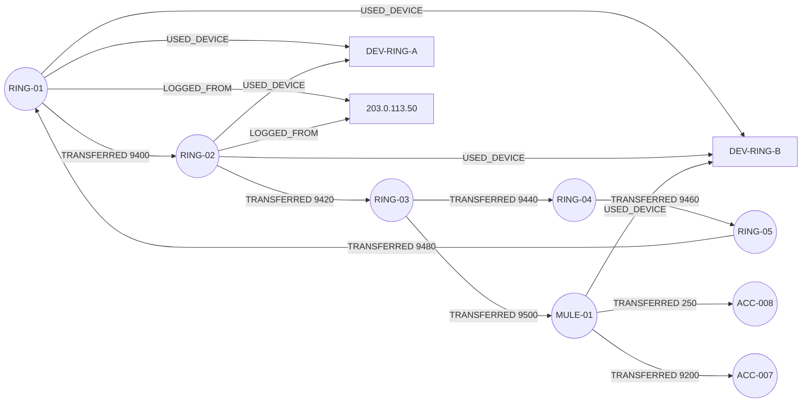

# Fraud Investigator: Track 01, Agents That Act on Connected Data

An agent that investigates suspicious accounts. A local LLM (via Ollama, no API key) reasons over a FalkorDB graph of accounts, devices, IPs and transfers by calling Cypher-backed tools. Every verdict is saved back into the graph as a `Case` that cites the evidence it used, so each decision can be traced.

**Status:** graph, tools, and MCP server verified against a live FalkorDB 4.x. See "Verification" below.

## Why a graph

The question "is this account part of a ring?" depends on how things connect. Two accounts
can look unrelated in a table, but share a device, log in from the same IP, and pass money
in a loop. Those links are one or two hops away, so the agent finds them with short traversals
instead of joins. FalkorDB evaluates these traversals as sparse matrix–vector multiplications
over a GraphBLAS adjacency matrix — the same algebraic engine that powers production-scale
fraud detection.

## Graph data model

```
(:Account {id, name, created_at})
(:Device  {id, fingerprint})
(:IP      {id})                       id is the address
(:Case    {id, session_key, verdict, summary, created_at,
           score, score_status, scoring_policy,
           flow_paths_json, confirmed_cycle_txns_json})

(:Account)-[:USED_DEVICE]->(:Device)
(:Account)-[:LOGGED_FROM]->(:IP)
(:Account)-[:TRANSFERRED {txn_id, amount, ts}]->(:Account)
(:Case)-[:INVESTIGATES]->(:Account)
(:Case)-[:CITES]->(:Account | :Device | :IP)
```

How the nodes connect (the planted ring and mule are shown in red):



The agent's tools traverse these edges. `shared_device_accounts` walks `USED_DEVICE` to find
the mule through `DEV-RING-B`. `money_cycles` walks `TRANSFERRED` back to the start account.

## How the graph drives every decision

The agent never uses heuristics or static rules. Every signal it reports comes from a live
Cypher query:

| Signal | Graph query | What it proves |
|---|---|---|
| Ring membership | `TRANSFERRED*2..8` cycle back to start | Money is circulating, not just flowing out |
| Shared infrastructure | `USED_DEVICE` / `LOGGED_FROM` | Two accounts operated from the same hardware or IP |
| Centrality (PageRank) | `CALL algo.pageRank('Account','TRANSFERRED')` | Account is a hub that receives from other hubs |
| Propagation risk | Monte Carlo over `TRANSFERRED` + shared-device/IP edges | Probability each neighbor is in the same scheme |
| Max-flow exposure | Edmonds-Karp on `TRANSFERRED` amounts as capacities | Theoretical upper bound on funds that can move between two accounts |
| Prior verdicts | `(Case)-[:INVESTIGATES]->(Account)` | Previous investigations inform confidence |
| Evidence provenance | `(Case)-[:CITES]->(Account\|Device\|IP)` | Every stored verdict cites exact node ids |

## Cypher tools

All of these live in `agent.py`, one per agent tool.

The `LIMIT` clauses on multi-hop tools are deliberate super-node guards: high-degree device or
account nodes can fan out combinatorially. The bounds cap the intermediate sparse-matrix
working set without changing which rings and cycles are found in the synthetic graph.

| Tool | Purpose | Core pattern |
|---|---|---|
| `get_account` | Verify the account exists | `MATCH (a:Account {id: $id})` |
| `shared_device_accounts` | Accounts that share a device | `(a)-[:USED_DEVICE]->(d)<-[:USED_DEVICE]-(o)` LIMIT 20 |
| `shared_ip_accounts` | Accounts that share an IP | `(a)-[:LOGGED_FROM]->(i)<-[:LOGGED_FROM]-(o)` LIMIT 20 |
| `outgoing_flows` | Money moving out, up to 4 hops | `(a)-[:TRANSFERRED*1..4]->(b)` LIMIT 25 |
| `incoming_flows` | Money moving in, up to 4 hops | `(source)-[:TRANSFERRED*1..4]->(target)` LIMIT 25 |
| `money_cycles` | Round-tripping money | `(a)-[:TRANSFERRED*2..8]->(a)` LIMIT 10 (configurable `max_depth`, clamped 3–10) |
| `connection_path` | Trace how money reached an account | `shortestPath((a)-[:TRANSFERRED*..8]->(b))` (directed) |
| `top_risk_accounts` | **Native FalkorDB PageRank** — neighborhood-scoped when `anchor_id` given | `CALL algo.pageRank(…)` filtered to 2-hop neighborhood |
| `risk_score` | Weighted composite score (0–100) from all graph signals | aggregates results of the other queries into a scored, explainable breakdown |
| `propagation_risk` | **Monte Carlo** fraud-spread probability to each transfer target | 40 trials per neighbor, factors: transfer frequency + shared device/IP |
| `max_flow_risk` | **Edmonds-Karp** maximum money flow between two accounts | transfer amounts as edge capacities; theoretical exfiltration upper bound |
| `prior_cases` | Memory of earlier decisions | `(c:Case)-[:INVESTIGATES]->(a)` |
| `record_case` | Write the verdict and its evidence | `MERGE (c:Case {session_key: $sk})` then `MERGE (c)-[:CITES]->(n)` |

## Setup

Requires Python 3.10+, Docker, and [Ollama](https://ollama.com). No API key is needed.

```bash
# 1. FalkorDB
docker run -p 6379:6379 -p 3000:3000 -it --rm falkordb/falkordb:latest

# 2. Python deps (inside a virtualenv; Homebrew Python blocks global installs)
python3 -m venv .venv
./.venv/bin/pip install -r requirements.txt

# 3. Synthetic data (60 customers, one planted ring, one mule)
python seed.py

# 4. Local model (no API key needed)
ollama pull qwen3:4b-instruct

# 5. Investigate
OLLAMA_MODEL=qwen3:4b-instruct ./.venv/bin/python agent.py ACC-RING-01
```

Optional environment variables: `FALKORDB_HOST`, `FALKORDB_PORT`, `FALKOR_GRAPH`, `OLLAMA_URL`,
`OLLAMA_MODEL` (default `llama3.2`; `qwen3:4b-instruct` gave the more reliable tool use in testing).

## MCP server

`mcp_server.py` exposes every tool from `agent.py` over the [Model Context Protocol](https://modelcontextprotocol.io)
stdio transport using **FastMCP**. Read tools are tagged `{"read"}` and `record_case` is tagged
`{"write"}`, so a client can mount a read-only view for general discovery agents while reserving
the write path for privileged investigation workflows.

```bash
# Install the mcp dependency (already in requirements.txt)
./.venv/bin/pip install mcp

# Run the server (keeps running; MCP client connects over stdio)
./.venv/bin/python mcp_server.py
```

To connect from Claude Desktop, add this to `claude_desktop_config.json`:

```json
{
  "mcpServers": {
    "fraud-graph": {
      "command": "/abs/path/to/.venv/bin/python",
      "args": ["/abs/path/to/mcp_server.py"]
    }
  }
}
```

The server advertises all 13 tools (including `top_risk_accounts`, `risk_score`,
`propagation_risk`, and `max_flow_risk`) using docstrings compiled to JSON Schema by FastMCP,
so tool selection works identically whether the client is the bundled agent loop or an external MCP host.

## Safety properties

- **Read / write isolation:** all discovery tools call `GRAPH.ro_query()` — the FalkorDB engine
  rejects any mutating clause at the protocol level. Only `record_case` calls `GRAPH.query()`.
- **Loop-lock guard:** the investigation loop tracks every `(tool, args)` pair. A duplicate call
  returns the cached result instead of re-running the query, preventing the model from cycling.
- **Context pruning:** when the message list exceeds 14 entries, the oldest tool results are
  dropped and replaced with a semantic summary that preserves risk scores, account ids, and
  cycle types found in the dropped results.
- **Idempotent verdicts:** `record_case` uses `investigation_id` (a UUID owned by the
  orchestrator, not the model) as `session_key`. `MERGE (c:Case {session_key: $sk})` is
  backed by a FalkorDB unique constraint, so concurrent retries return the existing case
  rather than creating duplicates.
- **Degraded score policy:** if PageRank is unavailable, `score_status="degraded"` and
  `record_case` requires an explicit `override_reason` before writing.

## Data

All data is synthetic, generated by `seed.py` with a fixed random seed (`random.seed(7)`).
No real customers or transactions are used.

String properties (`Account.id`, `Device.id`, `Device.fingerprint`, `IP.id`) are written
with FalkorDB's `intern()` function, which interns categorical strings into a shared pointer
table. Repeated `WHERE n.id = $id` filters compare pointers rather than scanning characters —
roughly 75× faster on high-cardinality string filters at scale.

## Planted scenario

- `ACC-RING-01..05` share two devices and one IP. They pass about 9,400 around in a loop.
- `ACC-MULE-01` shares a ring device, receives 9,500 from `ACC-RING-03`, and splits it out to
  `ACC-007` and `ACC-008`.

A good run finds the shared device, reports the cycle, and traces the path from the mule back to the ring.
`top_risk_accounts` will surface the ring accounts near the top of the PageRank list because they
receive repeated transfers from each other — a structural signature that the Cypher tools then
confirm with explicit traversals.

## Verification

- Against a live FalkorDB 4.x container: `seed.py` loads 66 accounts, 42 devices, 41 IPs and
  158 transfers. The Cypher tools return the planted ring and mule as expected. `connection_path`
  was rewritten to follow transfer direction after FalkorDB rejected undirected `shortestPath`.
- End to end with a local model (`qwen3:4b-instruct` via Ollama): the agent made 8 tool calls,
  traced the ring, the cycle and the mule, and saved a HIGH `Case` citing 11 ids. A run with
  `llama3.2` stopped after one call, so it is not the default.
- The agent occasionally describes `record_case` in text without calling it. The loop asks once
  for the real call before stopping. Check the graph for a new `Case` node after each run.

## Running tests

```bash
./.venv/bin/python -m unittest tests -v
```

All 82 unit tests run without a live FalkorDB (FalkorDB is stubbed). They cover:
cycle chronology, configurable cycle depth (3–10 hops), neighborhood-scoped PageRank,
flow path provenance, MCP access control (default-deny, API-key auth), verdict enforcement,
evidence label validation, breakdown JSON persistence, traversal truncation detection,
MERGE-based idempotency, cycle txn_id provenance, loop-lock caching, semantic pruning,
investigation_id idempotency, degraded-score policy, incoming flows, `_validate_evidence_ids`
per-id errors, uniqueness constraint enforcement, Monte Carlo propagation risk, and
Edmonds-Karp max-flow correctness.

## Known limitations

- **Cycle scoring uses confirmed-chronological cycles only**: `money_cycles` validates timestamp order per edge. Structurally cyclic paths where transfers flow backward in time are classified `structural_only` and score zero points.
- **Monte Carlo propagation uses fixed probability factors**: `propagation_risk` estimates base probability from transfer frequency and shared infrastructure. A production version would calibrate these weights against labeled historical data.
- **Max-flow operates on a bounded graph snapshot**: `max_flow_risk` fetches up to 500 transfer edges. Very large graphs may need pagination or a native FalkorDB max-flow implementation.
- **PageRank is neighborhood-scoped via anchor_id**: `top_risk_accounts(anchor_id=...)` filters global PageRank to the 2-hop neighborhood. The global computation still runs over all Account nodes; a true subgraph projection would require FalkorDB graph projection support.
- **Write authorization uses a shared token**: `MCP_WRITE_API_KEY` adds a second layer beyond the service kill-switch but is a static secret, not per-user credentials.

## AI assistance disclosure

Built with Claude Code (Claude) for scaffolding and drafting. The graph model and Cypher were
reviewed by hand and verified against a running FalkorDB before submission.
